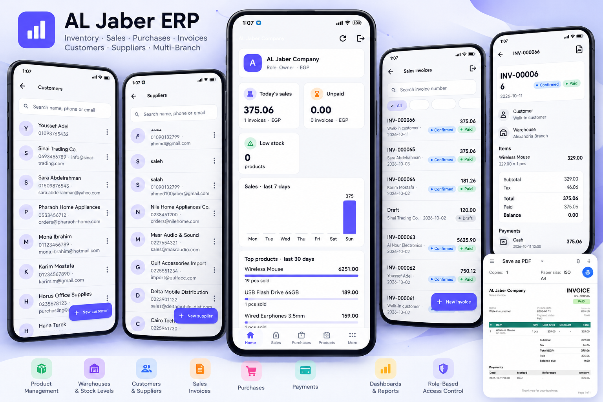

<div align="center">

# 🏢 ERP Management System

### Multi-Company Enterprise Resource Planning System

A modern, cross-platform ERP application built with
**Flutter, Supabase, and PostgreSQL**.

Designed to simplify business operations, manage
inventory, track sales and purchases, and provide
real-time business insights.


</div>

---

## 📸 Project Preview

<div align="center">

<a href="3fbed84e-5dbe-495b-b5a8-cbcdecf68e66.png">
  
</a>

</div>

---

## 📖 About the Project

ERP Management System is a comprehensive business
management application developed using Flutter
and Supabase.

The system supports multiple companies, allowing
businesses to manage their operations through
a centralized and user-friendly interface.

It provides tools for managing products, warehouses,
customers, suppliers, invoices, payments,
and employee permissions.

---

## ✨ Key Features

### 🏢 Multi-Company Management
- Manage multiple companies.
- Separate company data.
- Company-specific business operations.

### 📦 Inventory Management
- Add, update, and manage products.
- Manage multiple warehouses.
- Track stock quantities.
- Monitor inventory movements.
- Low-stock alerts.
- Minimum stock level tracking.

### 🧾 Sales Management
- Create and manage sales invoices.
- Invoice workflow:
  Draft → Confirmed → Cancelled.
- Full and partial payments.
- Track unpaid and overdue invoices.
- Generate printable PDF invoices.

### 🛒 Purchase Management
- Manage purchase orders.
- Supplier management.
- Receive purchased products.
- Automatically update stock upon receipt.

### 👥 Customer & Supplier Management
- Manage customer records.
- Manage supplier information.
- Track related business transactions.

### 🔐 Authentication & Authorization
- Secure user authentication.
- Role-Based Access Control (RBAC).
- Custom employee roles and permissions.
- PostgreSQL Row Level Security (RLS).
- Company-level data isolation.

### 📊 Dashboard & Analytics
- Today's sales overview.
- Sales performance charts.
- Top-selling products.
- Low-stock monitoring.
- Unpaid and overdue invoice tracking.
- Business performance insights.

---

## 🛠️ Technologies Used

| Technology | Purpose |
|------------|---------|
| Flutter | Cross-platform UI |
| Dart | Application development |
| Supabase | Backend services |
| PostgreSQL | Database |
| Supabase Auth | Authentication |
| PostgreSQL RLS | Data security |
| REST APIs | Data communication |
| Git & GitHub | Version control |

---

## 🏗️ System Architecture

The application integrates Flutter with
Supabase backend services.

```text
Flutter Application
        |
        v
Application Logic
        |
        v
Supabase Backend
        |
        +---- Authentication
        |
        +---- PostgreSQL Database
        |
        +---- Row Level Security
        |
        +---- Business Data
```

---

## 🚀 Getting Started

### Prerequisites

Before running the application, install:

- Flutter SDK
- Dart SDK
- Android Studio or VS Code
- Git
- A Supabase project

### 1. Clone the Repository

```bash
git clone https://github.com/AhmedJaberAhmed/ERP-System.git
```

### 2. Navigate to the Project

```bash
cd ERP-System
```

### 3. Install Dependencies

```bash
flutter pub get
```

### 4. Configure Supabase

Create a Supabase project and configure
the application with your Supabase URL
and publishable/anon key.

Ensure the required database tables,
policies, and authentication settings
are configured before running the app.

Never expose a Supabase service-role key
inside the Flutter application.

### 5. Run the Application

```bash
flutter run
```

Note: The application requires the
corresponding Supabase database schema
and backend configuration.

---

## 💡 Development Highlights

This project focuses on solving real-world
business management challenges.

Key technical challenges include:

- Maintaining accurate inventory records.
- Handling invoice and payment workflows.
- Managing multiple companies securely.
- Implementing granular employee permissions.
- Ensuring consistent business transactions.
- Designing a scalable database structure.

---

## 🎯 Project Goals

- Simplify daily business operations.
- Improve inventory accuracy.
- Centralize business information.
- Provide actionable business insights.
- Support secure multi-company operations.
- Reduce manual administrative work.

---

## 👨‍💻 Developer

**Ahmed Jaber Ahmed**

Flutter Developer | Software Developer

Computer Science & Artificial Intelligence Graduate

📍 Cairo, Egypt

- GitHub: [AhmedJaberAhmed](https://github.com/AhmedJaberAhmed)
- Portfolio: [My Portfolio](https://ahmedjaberahmed.github.io/Jaber-website/)
- LinkedIn: [Ahmed Jaber Ahmed](https://www.linkedin.com/in/ahmedjaberahmed/)

---

<div align="center">

### ⭐ Support the Project

If you find this project interesting,
consider giving it a star!

**Built with Flutter ❤️**

</div>
